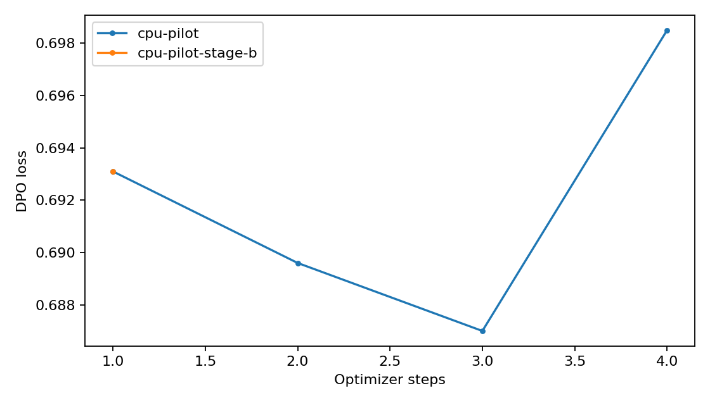

# Results generated from CSV logs

| Run | Kind | Metric | Observed value | Samples / training steps |
|---|---|---|---:|---:|
| [cpu-pilot](runs/cpu-pilot/metrics.csv) | dpo (16 pairs, max_steps=4) | train_loss | 0.692071 | 4 |
| [cpu-pilot](runs/cpu-pilot/metrics.csv) | dpo (16 pairs, max_steps=4) | train_runtime | 6.831600 | 4 |
| [cpu-pilot-code-prefs](runs/cpu-pilot-code-prefs/metrics.csv) | code_prefs | pairs | 2.000000 | 32 |
| [cpu-pilot-code-prefs](runs/cpu-pilot-code-prefs/metrics.csv) | code_prefs | sample_pass_rate | 0.468750 | 32 |
| [cpu-pilot-mbpp-base](runs/cpu-pilot-mbpp-base/metrics.csv) | mbpp | pass_at_1 | 0.500000 | 8 |
| [cpu-pilot-mbpp-stage-a](runs/cpu-pilot-mbpp-stage-a/metrics.csv) | mbpp | pass_at_1 | 0.500000 | 8 |
| [cpu-pilot-mbpp-stage-b](runs/cpu-pilot-mbpp-stage-b/metrics.csv) | mbpp | pass_at_1 | 0.500000 | 8 |
| [cpu-pilot-rm](runs/cpu-pilot-rm/metrics.csv) | rm | mean_rm_base | -1.005402 | 8 |
| [cpu-pilot-rm](runs/cpu-pilot-rm/metrics.csv) | rm | mean_rm_dpo | -1.005402 | 8 |
| [cpu-pilot-rm](runs/cpu-pilot-rm/metrics.csv) | rm | mean_win | 0.500000 | 8 |
| [cpu-pilot-rm](runs/cpu-pilot-rm/metrics.csv) | rm | mean_drift | 0.000135 | 8 |
| [cpu-pilot-stage-b](runs/cpu-pilot-stage-b/metrics.csv) | dpo (2 pairs, max_steps=-1) | train_loss | 0.693147 | 1 |
| [cpu-pilot-stage-b](runs/cpu-pilot-stage-b/metrics.csv) | dpo (2 pairs, max_steps=-1) | train_runtime | 7.489400 | 1 |

CPU pilot runs are integration checks, not the requested 5,000-pair Stage A result. A training loss is not evidence of preference improvement. Full 300-prompt reward-model evaluation and 257-problem MBPP results appear only after those commands complete.

Drift is the mean per-token log probability difference on greedy DPO continuations, including EOS. It is a signed drift proxy, not an unbiased KL estimator. Reward-model ties count as half wins. Scores use 512-token truncation.
