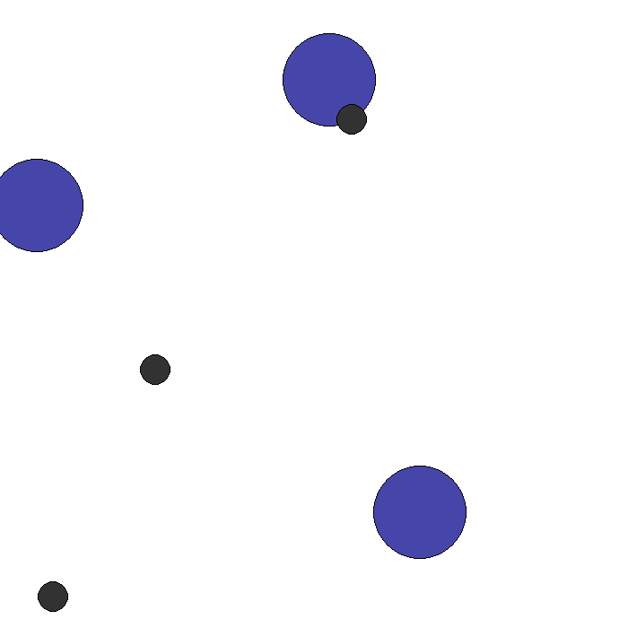
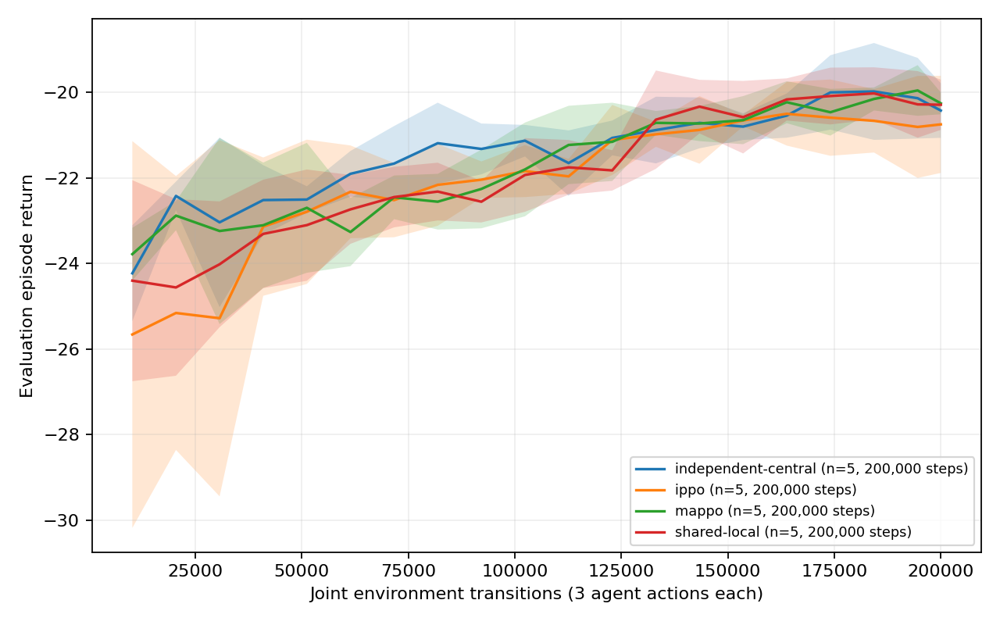
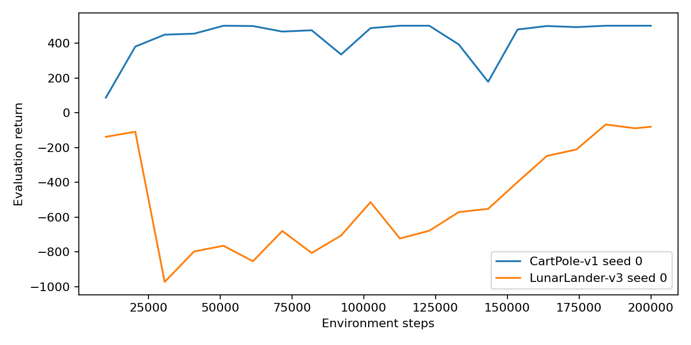

# PPO from scratch: independent vs centralized multi-agent learning

[Analysis and interpretation](DISCUSSION.md) · [Combined research report](../RESEARCH_REPORT.md)

**Question:** do a centralized critic and actor parameter sharing improve cooperative
coverage under the same sample budget? This is a deliberately small experiment;
poor learning and negative results remain visible in the logs.

`ppo.py` implements GAE, the clipped surrogate, squared value loss, entropy bonus,
minibatch epochs, per-agent advantage normalization and gradient clipping. Defaults:
γ=0.99, λ=0.95, clip=0.2, learning rate=3e−4, 4 update epochs, 256 time/environment
samples per minibatch, value coefficient=0.5 on half-MSE, entropy coefficient=0.01,
gradient norm limit=0.5. Separate 64×64 tanh actor/critic MLPs use orthogonal initialization.
True terminations do not bootstrap; time limits bootstrap the final observation,
and both stop recursive GAE across resets. Unit tests cover these distinctions.

The factorial grid is:

| CLI algorithm | Actor parameters | Critic input | Critic parameters |
|---|---|---|---|
| `ippo` | independent per agent | local observation | independent |
| `shared-local` | shared + one-hot agent ID | local observation | shared |
| `independent-central` | independent | global state | independent |
| `mappo` | shared + one-hot agent ID | global state | shared |

Sharing applies to both actor and critic networks; this is a documented design
choice rather than an actor-only sharing ablation. Shared centralized critics
estimate the common team value. Execution uses local observations only.

## Exact commands

From repository root after `make setup`:

```bash
make test
.venv/bin/python marl-ppo/train_single.py --out marl-ppo/runs/cartpole-rerun --steps 200000
.venv/bin/python marl-ppo/train_single.py --env LunarLander-v3 --out marl-ppo/runs/lunar-rerun --steps 200000
.venv/bin/python scripts/run_marl_suite.py --out marl-ppo/reruns --workers 1 --steps 200000
.venv/bin/python marl-ppo/plot.py --runs marl-ppo/reruns
# Individual run, including GIF:
.venv/bin/python marl-ppo/train_marl.py --algo mappo --seed 12 --steps 200000 --out marl-ppo/runs/mappo-seed12 --gif
```

Append `--wandb` to training/suite commands for W&B. Install `swig` before
`box2d-py` (the Makefile handles this). LunarLander-v3 is the Gymnasium 1.1.1 version.
PettingZoo is pinned to 1.24.3 to retain `pettingzoo.mpe.simple_spread_v3`.

## Protocol and interpretation

Simple Spread uses N=3, discrete actions, local_ratio=0.5 and 25-step episodes.
Each seed receives **200,000 joint environment transitions** (600,000 agent
transitions), four independent environments, horizon 128. Seeds are 0–4. Every
10,240 steps and at the final step, deterministic policies run 20 episodes with
seeds 20000–20019. CartPole/LunarLander use eight environments and evaluation seeds
10000–10019. These seeds are monitoring/evaluation seeds, not a tuned validation
set; do not optimize hyperparameters against them and claim independent test performance.

Episode return sums the **mean reward across agents**, not the sum across agents.
Coverage is the per-step fraction of landmarks whose nearest agent is within
one agent radius (0.15); collisions count unordered overlapping agent pairs per
step. Both are averaged over the 25 steps and evaluation episodes. Training
metrics include losses, entropy, gradient norm, approximate KL and clip fraction.

Runs include CPU/platform/software metadata in `runs/*/config.json`. Initial runs
used Apple M1 Pro (10 cores, 16 GiB RAM), macOS arm64 CPU, with one PyTorch thread per process. Some grid jobs ran
concurrently: their elapsed times include contention and evaluation; they are
not clean algorithm throughput benchmarks. GIFs are in `runs/*/policy.gif`.



<!-- RESULTS_START -->
# Results generated from completed CSV logs

No smoothing or best-checkpoint selection. MARL return is the sum of per-step mean agent rewards; bands and table deviations are across seeds (sample standard deviation). Evaluation uses 20 fixed environment seeds and deterministic actions.

| Single-agent run | Seed | Steps | Final eval return ± episode std | Wall seconds |
|---|---:|---:|---:|---:|
| CartPole-v1 | 0 | 200000 | 500.00 ± 0.00 | 39.4 |
| LunarLander-v3 | 0 | 200000 | -80.55 ± 22.46 | 58.8 |

| Algorithm | Completed seeds | Joint env steps/seed | Return ± std | Coverage ± std | Collision pairs/step ± std | Wall seconds ± std |
|---|---:|---:|---:|---:|---:|---:|
| independent-central | 5 | 200000 | -20.427 ± 0.638 | 0.057 ± 0.011 | 0.105 ± 0.050 | 96.278 ± 8.488 |
| ippo | 5 | 200000 | -20.750 ± 1.135 | 0.048 ± 0.010 | 0.090 ± 0.039 | 85.355 ± 6.282 |
| mappo | 5 | 200000 | -20.259 ± 0.256 | 0.054 ± 0.013 | 0.094 ± 0.045 | 85.755 ± 4.460 |
| shared-local | 5 | 200000 | -20.292 ± 0.587 | 0.060 ± 0.018 | 0.092 ± 0.045 | 86.956 ± 4.514 |

Wall time includes training and evaluation, excludes GIF rendering. Concurrent suite runs contend for CPU; do not infer algorithm speed from this grid.





Source logs: [cartpole-seed0](runs/cartpole-seed0/metrics.csv), [independent-central-seed0](runs/independent-central-seed0/metrics.csv), [independent-central-seed1](runs/independent-central-seed1/metrics.csv), [independent-central-seed2](runs/independent-central-seed2/metrics.csv), [independent-central-seed3](runs/independent-central-seed3/metrics.csv), [independent-central-seed4](runs/independent-central-seed4/metrics.csv), [ippo-seed0](runs/ippo-seed0/metrics.csv), [ippo-seed1](runs/ippo-seed1/metrics.csv), [ippo-seed2](runs/ippo-seed2/metrics.csv), [ippo-seed3](runs/ippo-seed3/metrics.csv), [ippo-seed4](runs/ippo-seed4/metrics.csv), [lunarlander-seed0](runs/lunarlander-seed0/metrics.csv), [mappo-seed0](runs/mappo-seed0/metrics.csv), [mappo-seed1](runs/mappo-seed1/metrics.csv), [mappo-seed2](runs/mappo-seed2/metrics.csv), [mappo-seed3](runs/mappo-seed3/metrics.csv), [mappo-seed4](runs/mappo-seed4/metrics.csv), [shared-local-seed0](runs/shared-local-seed0/metrics.csv), [shared-local-seed1](runs/shared-local-seed1/metrics.csv), [shared-local-seed2](runs/shared-local-seed2/metrics.csv), [shared-local-seed3](runs/shared-local-seed3/metrics.csv), [shared-local-seed4](runs/shared-local-seed4/metrics.csv)
<!-- RESULTS_END -->

## Limitations

Five seeds and a 200k budget support a small portfolio experiment, not a strong
benchmark claim. No observation/reward normalization, continuous-action PPO,
recurrent policies, hyperparameter search or optimized vector environment backend.
A short LunarLander run may fail to solve the task. Evaluation bands represent
variation across training seeds, not uncertainty from the evaluation episodes.
Deterministic PyTorch operations are requested, but reproducibility across hardware,
BLAS, Box2D and operating-system versions is not guaranteed. Checkpoints are
excluded from Git; reproduce them with the recorded commands and seed/config.

Sources: [PPO](https://arxiv.org/abs/1707.06347), [GAE](https://arxiv.org/abs/1506.02438),
[MAPPO](https://arxiv.org/abs/2103.01955),
[PettingZoo 1.24.3 source](https://github.com/Farama-Foundation/PettingZoo/tree/1.24.3/pettingzoo/mpe/simple_spread).
